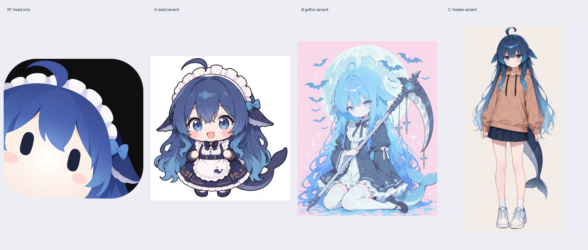

# DeepSeek full：服饰参考候选与同身份边界

研究时间：2026-09-29；本次有界调查约10分钟。用户已选择“先固定服饰参考”，因此没有把颈领草案推进为正式full。r1的数值验收另由主线程处理。

## 结论

**本次检查范围内，没有找到能确认是Cetus/r1同一张头像对应的全身或衣领原图。** Cetus固定提交的资源树只发现该头像、同构图splash、站点版本与界面标志，没有新增衣装观察。[Cetus固定仓库](https://github.com/AvroraCL/CETUS-Desktop/tree/7f14ea7819dfb025bafce2f0d088e4901aefead6)、[README原文](https://raw.githubusercontent.com/AvroraCL/CETUS-Desktop/7f14ea7819dfb025bafce2f0d088e4901aefead6/README.md)

下列三张是真实取得并查看的**衣装替代参考候选**，都不能称为r1的已确认官方服饰或同一canon。A保留了r1最多的可见组合特征；B/C来自同一鲸鱼娘作者页面，但衣装、色调和附件不同。是否使用其中某张，仍须用户固定参考；本报告不替用户选择。

## 已核查的Cetus材料

固定提交：`7f14ea7819dfb025bafce2f0d088e4901aefead6`。读取既有完整`upstream-tree.json`，重新取得README与三项应用资源，并逐张查看。

| 资源 | 真实观察 | 本次判定 |
|---|---|---|
| [docs/CETUS-ico.png](https://raw.githubusercontent.com/AvroraCL/CETUS-Desktop/7f14ea7819dfb025bafce2f0d088e4901aefead6/docs/CETUS-ico.png) | r1同图4096头像，头部以下被裁掉 | 锁定身份、不能提供衣装 |
| [cetus-splash.png](https://raw.githubusercontent.com/AvroraCL/CETUS-Desktop/7f14ea7819dfb025bafce2f0d088e4901aefead6/src/Cetus.Desktop/Assets/cetus-splash.png) | 同一近景头像，仍没有可见领口 | 排除为新增服饰证据 |
| [cetus-titlebar.png](https://raw.githubusercontent.com/AvroraCL/CETUS-Desktop/7f14ea7819dfb025bafce2f0d088e4901aefead6/src/Cetus.Desktop/Assets/cetus-titlebar.png) | 浅色透明界面资源，未呈现角色衣装 | 排除 |
| [logo.png](https://raw.githubusercontent.com/AvroraCL/CETUS-Desktop/7f14ea7819dfb025bafce2f0d088e4901aefead6/src/Cetus.Desktop/Assets/logo.png) | 白色几何标志 | 排除 |

仓库宣称MIT不自动证明独立图像的画师和资产权利链。本次没有发现可将其他女仆图直接认定为r1服饰原型的作者说明。否定结论仅覆盖本次固定提交和检索范围，不能推广为网络上必然不存在。

## 三张视觉筛选候选

| 候选ID | 直接可见的衣装 | 与r1共同特征 | 关键差异与适用限制 |
|---|---|---|---|
| `outfit_a_maid`：女仆Q版 | 深蓝上衣/裙身、白色褶边胸片与围裙、深蓝领结、小菱形饰件、双肩深蓝带 | 深蓝长发、宽弯钩呆毛、白头褶、蓝侧结、头侧宽鳍与浅色边 | 表情、圆虹膜、发型细部、体型与r1不同；没有证据证明是r1作者同一设定。可作为“指定使用此女仆衣装”的明确新参考，不把胸前鲸鱼图案、裙饰、尾巴自动带进头像 |
| `outfit_b_gothic`：哥特褶领版 | 高褶领、深色领带结、白色纵向门襟和大弧形胸前褶边、深色长袖 | 蓝色长发、头侧鳍、顶部呆毛、鲸尾谱系 | 发色偏浅蓝、无r1白头箍与侧蓝结，服饰另有主题装饰；属于明显替代衣装。只可在用户明确选择后提取颈领/上胸，不能把武器或十字装饰当r1必需身份 |
| `outfit_c_hoodie`：日常卫衣版 | 驼色连帽卫衣、两条黑抽绳、深蓝短裙 | 深蓝长发、顶部弯呆毛、头侧鳍与鲸尾 | 没有女仆头饰、围裙或领结；这是最明显的服饰改设定。只供用户主动选择日常版，不能用于证明r1穿卫衣 |

### A：传播仓库中的女仆Q版

- [来源仓库与署名说明](https://github.com/fornarwhal/deepseek-whale-girl-icon)、[原图URL](https://raw.githubusercontent.com/fornarwhal/deepseek-whale-girl-icon/main/original-whale-girl.jpg)。本次实际读取README，仓库同时列出角色/二创/修复署名与CC BY-NC-SA 4.0，也明确表示网络流传图片的具体作者未确认，不能将这条署名链视为已经完整核验的权利证明。
- 取得：2026-09-29 07:20:44 UTC；910×941 RGB，91,444 bytes。
- SHA-256：`c1d8ced2d461348d14128178dc7950ab037583aee27516dfa69ec0f7d5def3b2`。
- 本地：[candidate-a-maid.jpg](../../../ref/subjects/deepseek/outfit-research/candidate-a-maid.jpg)。本次查看既有缓存，重新下载字节与缓存哈希一致，随后又在本次候选总览中查看。
- 视觉筛选理由：在已查材料中同时保留弯钩、头褶、侧鳍浅边和蓝侧结，且领口/上胸清楚。此处是同形态观察，**不等于同作者、同canon或官方**。

### B、C：鲸鱼娘作者页面的两张附图

- [上善无形的原发布页面](https://www.bilibili.com/opus/1231977657712771073)（页面显示2026-08-02），正文给出鲸鱼娘形态说明并标示CC BY-NC-SA 4.0。该许可陈述限于其发布内容；不自动覆盖r1或A。
- B [图像URL](https://i0.hdslb.com/bfs/new_dyn/3c682551e90b44b1a02c01ed337b22884456176.png)，2026-09-29 07:20:45 UTC取得，1024×1280，1,372,289 bytes，SHA-256 `527b8911e690686424415991ffeb2f9e979b5f2b87b4c56640599ec9928d9940`；[本地文件](../../../ref/subjects/deepseek/outfit-research/candidate-b-gothic.png)。视觉筛选理由是高褶领和胸前布片清楚，人物配件与r1差异明显，须作为替代方案。
- C [图像URL](https://i0.hdslb.com/bfs/new_dyn/d46536f7163fd739bb6e105c3d964b834456176.png)，2026-09-29 07:20:45 UTC取得，263×560，173,777 bytes，SHA-256 `0d9150f6c6a49289010709c8af456ea909f779012a792ecf37e34953f4579ce2`；[本地文件](../../../ref/subjects/deepseek/outfit-research/candidate-c-hoodie.png)。分辨率低于A/B，但卫衣领、帽缘和抽绳关系清楚；不适合推断不可见的小饰件。
- 两图均实际查看，三张候选没有混成一个服装。任何选定图的版权/署名仍须随最终分发用途另核；本次只保留私有研究参考，不纳入可再分发Skill资产。

## 检索范围、失败与停止点

按AnySearch要求先查询`social_media`域，再批量查询 `"CETUS-Desktop" "女仆"`、`"AvroraCL" "CETUS" "立绘"`，并作 `DeepSeek Grok 女仆` 的X媒体域搜索。前两项只返回第三方项目汇总，社交结果没有同图衣装证据；未把无关结果当候选。原输出保存在[anysearch-search.txt](../../../ref/subjects/deepseek/outfit-research/anysearch-search.txt)。一次控制台GBK编码错误发生在搜索结果已保存后，只读取已保存结果恢复，没有重复网络检索。

公共网页读取Cetus固定GitHub树失败；直接固定raw README及三个资源成功，既有固定树也可读。Fornarwhal仓库与Bilibili原发布正文均成功读取。没有找到更多能加强同图作者链的材料后停止，没有为凑数量加入第四个衣装候选。

本次请求均为公开关键词/URL，没有上传本地角色图给外部服务。检索/下载命令45秒硬上限，单下载22秒，临时并发仅为独立小文件HTTP读取，无安装、无Git变更、无常驻浏览器。取得日志见[candidate-retrieval.json](../../../ref/subjects/deepseek/outfit-research/candidate-retrieval.json)与[cetus-retrieval.json](../../../ref/subjects/deepseek/outfit-research/cetus-retrieval.json)。

## 当前决定状态

`deepseek_full_clothing=先固定服饰参考` 已由主线程传达真实用户回答。`outfit_a_maid / outfit_b_gothic / outfit_c_hoodie` **全部未选**；没有Jev评分、没有代填概率、没有默认成为用户选择。本轮没有发布正式full成品，也没有据这些候选继续绘制。
