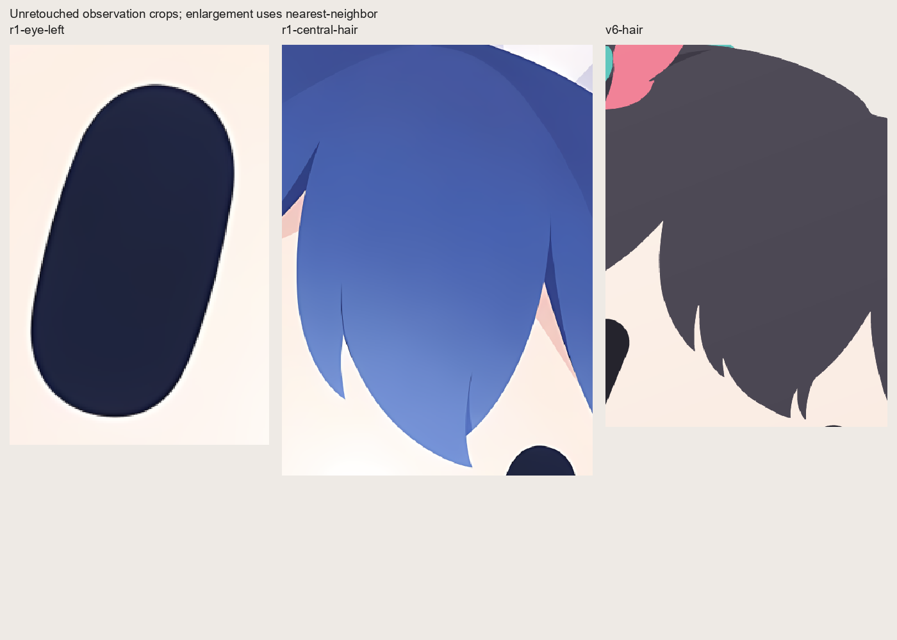
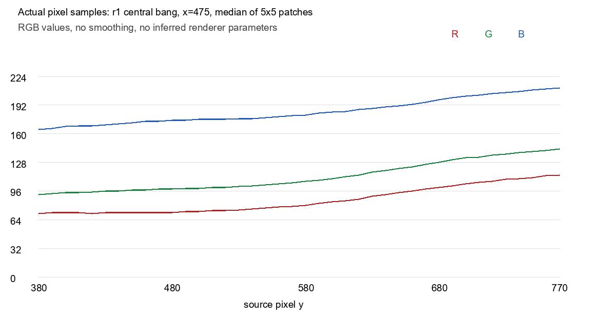

# 自然光泽与双版本区分：2026-09-29 参考复核

## 结论与本次反馈的效力

用户本轮明确指出 r1 的高光、渐变与眼部/头发光泽是目标，拒绝上一轮几乎完全扁平且难以区分的双版本。运行合同需要允许这些特征；源提示词的忠实译文仍保留原貌。尤其是“眼内一律纯色”“禁止任何眼部 gradient”不能继续作为本轮生产硬规则。该变更来自用户最新指令，不是推断用户选择。

本次指定的完整版图用于**整体观感、发束层次与身份部件信息量**。它仍含上一轮已指出的云纹、无依据尖亮片，不能把整张参考的所有上色像素视为正确答案。上一轮 v6 的反方向错误是：移除异常上色时，也移除了关键发束分组与可见色场。

## 实际查看的直接证据

| 材料 | 本轮用途 | 观察与定位 |
| --- | --- | --- |
| [r1 原图](../../ref/user-mode/r1.png) | DeepSeek 主体与强模式参考 | 实际查看原图、眼部 3 倍最近邻裁切、中央/侧边头发、蕾丝/蝴蝶结；不移植黑底或水印 |
| [本次完整版附件的仓库同字节副本](../../outputs/calibration/illustration/full-imagegen-v1.png) | 完整版整体观感 | 实际查看用户附件原图和中央刘海裁切；其整体正面反馈不覆盖之前的纹理/亮片否定 |
| [v6 完整版](../../outputs/paint-v6/illustration/full-1024.png) | 失败对照 | 中央前发成为过大的单一材料面，眼睛为单色平面，双版几何不变 |
| [原始完整译文](../../skills/aikon/references/prompts/source-full.zh-CN.md)、[精简译文](../../skills/aikon/references/prompts/source-short.zh-CN.md) | 源规则与当前覆盖的边界 | 原文支持两个胶囊眼、无鼻嘴、近景；原文的纯色眼限制与本轮用户强参考冲突，需要明确覆盖 |

附件路径此前带 `/C:/` 导致 Windows 读取失败。本轮使用正确 `C:/` 路径成功读取；没有要求用户重新上传。实际核对附件与仓库已有 `full-imagegen-v1.png` 的 SHA-256 均为 `a1fb6a12a85140bdea4697a43c98dbd5ce7d1a118d6eacc51c1bc6763f4dd1c1`，上表因此链接可持续读取的仓库副本。来源 SHA-256、尺寸、每一裁切和采样位置记录在 [metrics.json](../validation/gloss-v2/metrics.json)。这些图仅作当前私有研究证据，不因此获得可再分发权利。

## r1 的光泽来自哪里

### 头发：宽连续色场和形体分组共同起作用

中央蓝发不是平色，也没有依靠许多亮片增加“精细度”。同一个宽发束的上部偏深蓝，下部更浅；侧发也沿主要发流发生宽缓变化。相邻发束借轮廓、遮挡、深蓝窄转面分开，亮部与发束曲率相容。深蓝头冠、中央大刘海、侧发与后发是不同的形体分组，而不是把一块大平面切成随机碎片。[中央原样裁切](../validation/gloss-v2/r1-central-hair.png)、[侧发裁切](../validation/gloss-v2/r1-side-hair.png)。

对同一中央发束内部的 9×9 像素块取 RGB 中位数，避开形体边界，得到：

| 原图中心坐标 | r1 RGB | 意义 |
| --- | --- | --- |
| (475, 380) | (71, 92, 165) | 上部深蓝 |
| (475, 580) | (80, 107, 181) | 中部过渡 |
| (475, 750) | (111, 140, 209) | 下部浅蓝 |

上、下采样在通道上相差 40、48、44 / 255。这不能转换成“必须使用这些颜色”的规则，但足以否定“合法渐变只能产生极小色差”的泛化。v6 的一组中央区域采样仅从 (78, 74, 86) 变为 (76, 72, 84)，几何又缺乏主要内部发束分组，画面呈现扁平大色块。[原始采样](../validation/gloss-v2/metrics.json)。

剖面只记录实际像素，不拟合“原作者用了哪种 gradient”。凭最终位图无法确定原作者采用线性、径向、手工矢量或其他上色管线；生产可以用确定性的简单解析场重建相近视觉效果。

### 眼睛：暗胶囊的微弱曲面，而非白色闪光点

[r1 左眼 3 倍原样放大](../validation/gloss-v2/r1-eye-left.png) 显示：整体仍是一只完整深蓝胶囊，没有虹膜、瞳孔、眼白或星点；内部有非常微弱的色场，边缘有狭窄的深色转面，贴近外缘还有细浅亮边。

眼内三个 9×9 像素块的中位数分别为 (32, 38, 65)、(31, 36, 61)、(30, 36, 62)。这与发束 40–48 个通道值的变化属于不同尺度，不能把头发的明暗幅度直接搬进眼睛。v6 对照三个采样全部为 (37, 36, 45)。[采样位置与结果](../validation/gloss-v2/metrics.json)。

横穿原图左眼 y=775 的剖面还有一个有用区别：背景脸色在 x=140 是 (253, 241, 232)，接近眼外缘 x=155 变为 (255, 251, 245)，眼边 x=158 变为 (11, 15, 34)，内部 x=162 回到 (32, 37, 63)。所以这条浅边不能全部解释为单纯从深眼色到脸色的抗锯齿混合；它确实比附近脸色更亮。生产时可以用很窄、强度受控且贴合胶囊曲率的边缘转面表达，但不要画成粗白描边或独立亮斑。[完整横剖面](../validation/gloss-v2/metrics.json)。

### 白色布件与蓝蝴蝶结：材料和折面有区别

[蕾丝与蝴蝶结裁切](../validation/gloss-v2/r1-frill-bow.png) 中，白色主表面有很弱的暖白变化，背面为灰紫折面；这些灰紫三角/曲面具有布片折叠依据，不应因为“三角”二字一律剔除。蓝色蝴蝶结的边缘与折面区别也受真实造型支撑。它们不是每一块都要独立拥有一个居中的放射亮心。

## 区分三类现象

| 现象 | 可见证据 | 生产处理 |
| --- | --- | --- |
| 自然低频光泽 | 同一曲面上方向稳定的宽缓变化；明暗跟随发束/眼/布件的曲率与遮挡；缩小后有体积而不显花 | 使用少量连续场与确有依据的转面；眼部强度远弱于头发；保留正确形体分组 |
| 无依据亮片或切面 | 软发面内悬浮三角、星形或多尖亮片；看不出是哪条发束的转面；多个亮心方向冲突 | 删除或重画成有形体依据的大区域；有 owner 标签也不能证明自然 |
| 云纹、颗粒与污染 | 一个平滑材料内部出现不规则高频或中频起伏；形体边界以外仍有脏纹；低 alpha 让背景参与主色 | 直接从干净解析色场生成，不量化/描摹缺陷；用对解析期望的残差和 alpha 检查定位 |

本次完整版参考的[中央刘海裁切](../validation/gloss-v2/full-reference-hair.png) 同时存在有用的发束边界、内部低频渐变、以及不该复制的云纹和尖亮片。因此应分别选取构图、分组、色场特性，不能全局磨平，也不能把整张当成像素匹配目标。

## 两个 profile 的可见合同

这是给后续绘制 Agent 的本轮实施假设，供用户查看新样本后审计；不是已经获得视觉批准的标准。它覆盖源规则中与最新强参考冲突的部分，仍共享相同主体身份、两个胶囊眼、无鼻嘴、透明背景和无水印。

| 维度 | short | full |
| --- | --- | --- |
| 主体信息 | 保留发型主轮廓与少量决定性部件，省略小连接与服饰细节 | 保留代表性的发束前后关系、部件折面与连接；必要时少量衣领/服饰裁片依本轮 full 参考进入边缘 |
| 几何分组 | 少量宽发束；简化弧形蕾丝或帽饰块数；保持 silhouette 可辨识 | 显著更丰富、仍以大形为主的发束组和遮挡；不要用细发丝、噪点或颜色碎片冒充几何 |
| 配色 | 较轻、更统一的粉彩；弱色场，少量有依据阴影 | 接近主体原色，较充分的宽缓深浅色场，保留 r1 的自然蓝发光泽与材料区别 |
| 眼睛 | 简洁暗胶囊，至多很弱内部变化与转面；不要求亮点 | 仍是暗胶囊，可有 r1 式微弱暗色场和细边缘光泽，无虹膜、瞳孔、白星点或粗框 |
| 完成度 | 用简化后的 geometry 与较少材料变化得到明确的图形感 | 用更完整 geometry、渐变和材料折面得到附图的整体丰富度；不追加任意光晕 |
| 必须保持 | 两眼完整、主体身份一致、稳定发流、干净 alpha | 同左；full 不能借“细节多”牺牲识别与近景可读性 |

区分的最低可审查条件是：隐藏 profile 标签，在头像尺寸的并排图中仍能指出至少两项实际区别，其中至少一项来自几何/信息量。只改十六进制颜色或文件字节不满足用户本轮要求。不要为达到差异而让两个 profile 变成不同角色。

对 DeepSeek，用户指定的 r1 本身同时携带身份与风格。短版可以简化蓝发、白蕾丝和侧蝴蝶结；完整版仍保留这些关系，并补足宽渐变及折面。不得再次改成蓝鲸，也不能把管理员或本次黑发珊瑚色角色的装饰移植给 DeepSeek。

## CI 应如何约束而不惩罚正确光泽

1. **检查所声明色场的偏差。** 如果本层声明为 linear/radial gradient，实际渲染结果应对照该场在同坐标 mask 内的期望像素。不要把全区颜色范围、全图不同颜色数、或相邻像素变化本身当成 grain。固定阈值只对明确的尺寸、mask、场与渲染器有效。
2. **显式标记小而合法的光泽。** 眼缘是窄区域，必然接近几何边界；将其和材料主表面分开检查，避免 smooth-field 检测将合法边缘转面当成亮岛，也避免把大块材料排除后“通过”。
3. **同时验证正常样例和注入缺陷。** 正常对照应包含这次 r1 幅度的宽渐变、弱眼内梯度、细边缘转面、布料折面；负面对照注入颗粒、云斑、alpha 污染、孤立亮片和接缝。对比必须使用同一个固定实现，不能看到好参考报警后静默放宽阈值。
4. **锚点是语义证据，不是统一距离定律。** 接收面与遮挡来源需明确；投影可以落在表面内部，宽曲面明暗也未必接触外轮廓。先前“阴影必须距离 owner 外边界 ≤2px”的规则只能作为那个 fixture 的约束，不能推广为通用物理规则。可自动检查越界、非法归属、颜色/透明度漂移；是否顺形仍需要实际看图。
5. **检查差异的意义，而非只检查 hash。** short/full 不同字节是必要的最低技术检查，不等于观感不同。保存独立几何分组、不同部件简化信息与同尺寸对比图，实际审查至少一项 geometry 差异及另一项可见差异。轮廓/像素差分可定位，但不能自动证明“更好”。
6. **深浅底、目标尺寸和放大图分别查看。** 内部 mask 噪声检查不覆盖边界，需要另查透明轮廓、细缝、暗边/亮边过强。输出图可在展示底上查看，SVG 本体仍透明；任何正确渲染的自然高光都不需要靠非预期主体半透明完成。

代码 SVG 可以令同一个明确 geometry + paint 在固定渲染器上可复现；这解决的是执行稳定性。它不自动解决不同模型如何做出同样的发束取舍、身份关系或审美判断。应把“固定输入可复现”和“新主体跨模型表现一致”分别留证。

## 验证范围

本研究实际查看了三张原图和局部裁切；实际采样、SHA-256 与无修饰证据图已保存。未为参考反推出声称真实的原作者 renderer，未对新绘图宣称视觉通过，未修改旧 SVG，也未把该研究的实施假设记录为用户验收。最新生成样本仍须由主线程实际渲染、看图并交给用户审计。
