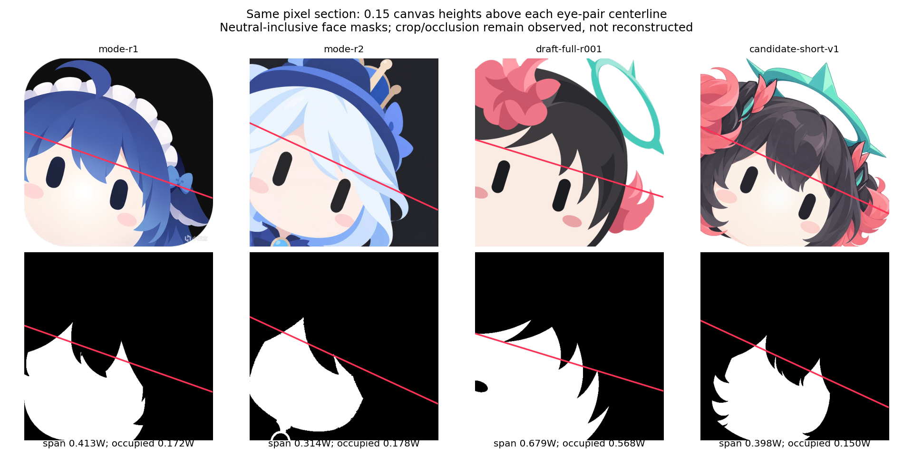
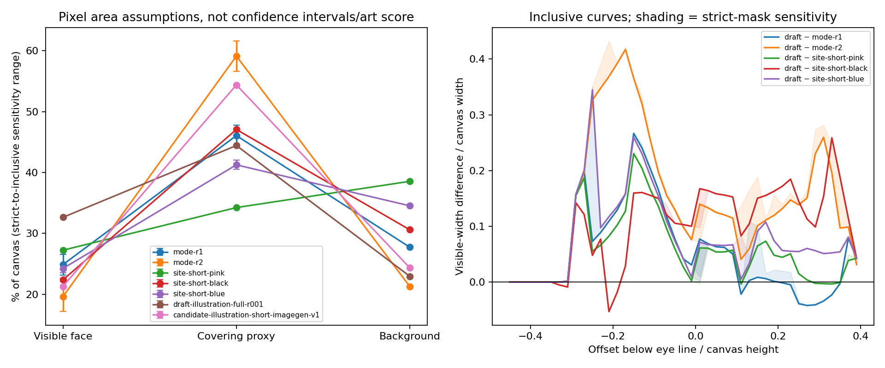
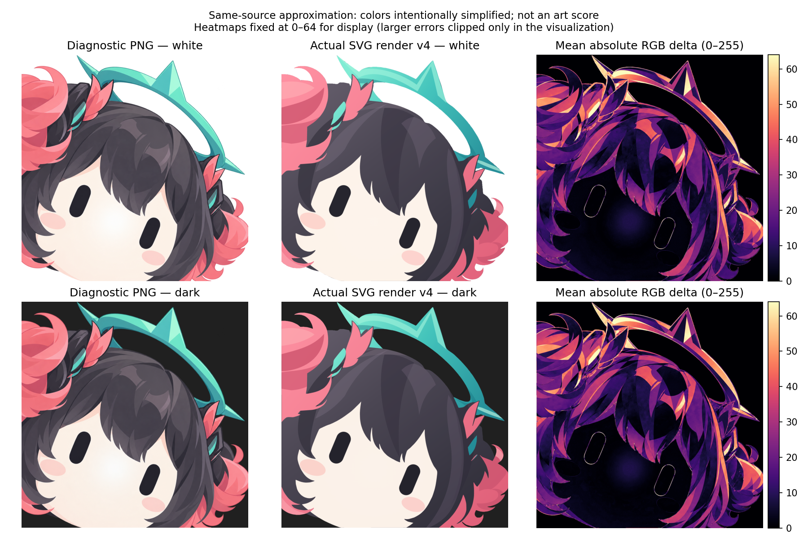

# 像素结构诊断：强模式参考、站点样例与被否决草稿

日期：2026-09-28。此报告诊断实际像素差距，不给美术评分，不撤销用户对旧稿的否决，也不把新 PNG 候选标为合格。未使用 MAE、SSIM、schema 通过或 alpha 正确来代替美术判断。

## 已有可反证发现

1. **r1 的眼部形状不是 3:1。** 独立连通域/PCA 测得左右长宽比约 **1.964 / 1.928**；r2 为 **2.709 / 2.812**。因此把所有强模式参考统一解释为固定 3:1，没有像素证据支持。当前脚本在阈值 80 和 100 下都得到 r1 约 1.93–1.96；阈值 60 会漏掉其蓝黑眼，不伪称该阈值仍然有效。
2. **旧稿的露肤—刘海关系明显不同。** 将各图按双眼中心连线建立局部坐标，在眼线上方 `0.15 × 画布高度` 的同一带状截面，旧稿实际被肤色代理占据的宽度为 **0.568W**；r1 是 **0.172W**，r2 是 **0.178W**。旧稿约为两者的 3.3 / 3.2 倍。该差距可以直接在下面红线与 mask 交界处检查，并不是从“圆脸”字样或 SVG 元素类型推断。
3. **旧稿的眼部位置和倾斜也没有与两张强参考校准。** 512 尺度下，旧稿双眼中点较 r1 左移约 **18.7 px**，较 r2 左移约 **15.4 px**；两眼中心连线角度为 **16.99°**，r1/r2 分别为 **19.44° / 24.82°**。这测的是眼对，不宣称能由此精确恢复整个头部的真实姿态。
4. **纯平肤色与参考的像素色阶有差异，但它不是独立的美术质量结论。** 所选肤色内区中，旧稿亮度标准差约 **0.19/255**，五张参考为 **1.86–7.25/255**。源图的纹理、渐变、压缩和分割范围都可能影响该值；不能把“更多色阶”直接等同于更好。



上排为实际图片，下排为中性色兼容分割的敏感性 mask。红线位于双眼中心连线上方 0.15H。`span` 是最左到最右露肤像素的跨度，`occupied` 排除了中间被刘海占据的空档；后者更能揭示本例的遮盖差异。两者都只描述可见像素，不能恢复被头发挡住的完整脸或头。

## 输入与复跑

先亲自查看了 r1、r2、站点 pink/black/blue，随后查看主 Agent 通过 Chrome canvas 从实际旧 SVG 渲染的 RGBA，以及新增的 native imagegen PNG。没有由文件名或 SVG 标签假装看过图。

| 输入 ID | 实际输入 | 在本报告中的角色 |
| --- | --- | --- |
| mode-r1 | 用户 `模式参考/r1.png`，1280×1280 | 强模式参考；排除右下水印与黑底 |
| mode-r2 | 用户 `模式参考/r2.png`，1254×1254 | 强模式参考；排除黑底 |
| site-short-pink / black / blue | `ref/site/short-*.png`，各 1254×1254 | 来源站点样例；不是相同人物的 ground truth |
| draft-illustration-full-r001 | `.local/calibration/illustration-full.png`，1024×1024 RGBA | 用户已否决的 full SVG r001 的实际渲染 |
| candidate-illustration-short-imagegen-v1 | `outputs/calibration/illustration/short-imagegen-v1.png`，1254×1254 RGBA | 新 short 诊断 PNG；不是 SVG、不是 gold、未获用户接受 |

精确本地路径、ROI 和参数保存在 [pixel-inputs.json](pixel-inputs.json)。每个输入的 SHA-256、原始尺寸、工具版本、所有条件数值及警告在 [pixel-metrics.json](pixels-final/pixel-metrics.json)；便于比较的平表是 [summary.csv](pixels-final/summary.csv)。原始输入和 SVG 没有被修改。

从仓库根目录执行：

```text
python -B -X utf8 tools/analyze_style_pixels.py --manifest docs/validation/calibration/pixel-inputs.json --output docs/validation/calibration/pixels-final --size 512 --timeout 60
```

脚本只使用已安装的 numpy、scipy、Pillow、matplotlib，不联网、不调用浏览器、不安装依赖。父进程启动独立 worker，并实施 60 秒硬超时；失败或超时不能把输出目录中残留的旧图当作本次成功结果，必须检查退出码。最后一轮运行耗时约 7.39 秒，退出码 0，运行记录在 [process-run.json](pixels-final/process-run.json)。环境为 Python 3.13.3、numpy 2.4.3、scipy 1.17.1、Pillow 12.1.1、matplotlib 3.10.8。

追加图片只需在 manifest 增加一个 asset：给出 `id/path/role`，指定 `alpha-only` 或黑底洪泛模式，并通过实际看图确定两眼 ROI 与肤色搜索 ROI。不能根据结果好坏改阈值；新图若失败就保留失败状态。此次新候选直接沿用了 site-short-black 的眼 ROI 和完全相同的阈值，未为它另调标准。

## 方法、公开假设与失败边界

### 尺度与排除区域

所有图片保持长宽比缩放到 512×512，使用 Lanczos；必要时透明补边。这里对齐的是画布，不对不同人物作像素对应或拉伸变形。

参考黑底采用右上明确背景 ROI 的 RGB 中位数作为种子颜色，取逐通道最大差不超过 12 的连接区域作洪泛；同时保存阈值 8 / 12 / 20 的敏感性 mask。透明图使用真实 alpha <128 作为未占据区域，源 PNG 的 RGB 黑色显示不自动被当作黑底。

r1 的水印使用归一化矩形 `[0.83, 0.92, 1.0, 1.0]` 排除，占画布约 1.36%。这是有意偏保守的手工 ROI，会同时排掉少量邻近内容，不是精确水印标注。实测、颜色统计和分割都不使用它。显式排除图为 [r1 水印 ROI](pixels-final/mode-r1/manual-exclusion.png)，黑底图为 [r1 background](pixels-final/mode-r1/background.png)。每张参考均保存独立 `background.png` 和三个阈值的背景 mask。

**已观察到失败：** site-short-black 的前景占比在阈值 8 / 12 下为 69.45% / 69.42%，阈值 20 时却降至 33.50%，说明黑发与背景颜色发生混淆。因此该图的“头发/背景面积”不能视作稳定语义标注；报告保留失败图 [background-tolerance-20.png](pixels-final/site-short-black/background-tolerance-20.png)，不删掉失败阈值后宣称算法可靠。

### 眼部连通域

在实际查看后登记的两眼 ROI 中，取 `max(R,G,B)<80` 的连接像素，剔除小于 20 px 的碎片，选最大连通域。对像素坐标做 PCA，分别投影到长/短轴，以投影最大值减最小值加 1 作为长度，计算像素重心和眼对连线。ROI、连通域与阈值 60 / 80 / 100 的结果均保存。

这些长宽比是暗色形状的像素近似，不是作者 SVG 的参数。PCA 轴角、像素边界、抗锯齿和采样分辨率都有误差。另一个研究 Agent 在原分辨率、不同 ROI/阈值上独立测得 r1 左右约 1.963 / 1.936，r2 约 2.717 / 2.820；这与本次先完成的独立 512 测量相符，但不把 Agent 一致当成人类 gold。

旧稿右眼 ROI 出现 3 个大于 20 px 的暗连通片；本轮实际查看 [选中的眼 mask](pixels-final/draft-illustration-full-r001/eyes.png)，最大域对应眼睛，小片来自邻近深色图形。保留该歧义警告，不将“自动找到一个域”写成完全无歧义识别。

### 肤色、脸部与头发代理

初始规则为 `R>175, G>135, B>110, R-G>4, G-B>3`，在公开 ROI 内取最大连通域，再填封闭孔洞。**初始规则失败了一部分：** r1/r2 的近白肤色被漏掉，在实际 mask 中形成不应有的孔洞。例如 r1 被查看的肤色点 `(254,251,247)` 因 R-G=3 被排除。初始输出保留在 `pixels/`，最终目录也继续保存原始 strict mask。

发现这项分割缺陷后，只追加一个透明说明的敏感性情况：保持亮度下限不变，使用 `R>=G>=B` 包含中性色；没有替换原 mask、没有把它指定为 gold，也没有调到某个期望的美术结果。r1/r2 的 strict→inclusive 脸区面积分别由 23.17%→26.56%、17.15%→22.08%。[总览图](pixels-final/pixel-mask-board.png) 同时显示两种分割，任何人都可核查哪里被改分类。

`covering_proxy` 是剩余前景，含头发、帽子、饰件和分割残差，**不能简称为已分割的头发**。触及画布边缘的腮红、服装接触和同色饰件也可能影响脸区。故以下脸部数字均标为代理区条件值；它们不是隐藏头形或头发面积的精确解剖测量。

## 眼部实测对照

位置和尺寸以画布归一化，0.1 对应 512 尺度的 51.2 px。连线角为图像坐标系下从左眼到右眼的顺时针角，不等同于整个角色的唯一头部旋转角。

| 图片 | 左 / 右长宽比 | 平均长度/W | 平均宽度/W | 双眼中点 (x,y) | 连线角 |
| --- | --- | --- | --- | --- | --- |
| r1 | 1.964 / 1.928 | 0.1651 | 0.0848 | (0.3337, 0.6655) | 19.44° |
| r2 | 2.709 / 2.812 | 0.1880 | 0.0681 | (0.3273, 0.6588) | 24.82° |
| pink | 2.611 / 2.708 | 0.1599 | 0.0602 | (0.3439, 0.6816) | 21.34° |
| black | 2.797 / 2.844 | 0.1552 | 0.0550 | (0.4083, 0.7063) | 22.04° |
| blue | 2.654 / 2.742 | 0.1552 | 0.0576 | (0.3415, 0.6938) | 20.59° |
| 旧 full SVG r001 | 2.723 / 2.721 | 0.1778 | 0.0653 | (0.2971, 0.6784) | 16.99° |
| 新 short PNG 候选 | 2.284 / 2.293 | 0.1472 | 0.0643 | (0.4112, 0.7170) | 24.81° |

旧稿相对 r1 的眼宽少约 23%，长度多约 7.7%；相对 r2 的尺寸则接近得多。两张强参考本身就不是一套等价几何，不能将其中任一数值混成“所有参考都符合的固定规范”。新候选的轴比介于两者之间，眼睛更短，中点显著靠右；这些是变化，不是自动通过。

## 脸形暴露与刘海遮盖

中性包含分割下的面积及眼线上方 0.15H 截面如下。所有百分比以整个画布为分母，r1 水印区单独排除。

| 图片 | 可见脸代理面积 | 头发+附件等剩余前景代理 | 截面最外跨度/W | 截面实际露肤占据宽度/W |
| --- | --- | --- | --- | --- |
| r1 | 26.56% | 44.36% | 0.413 | 0.172 |
| r2 | 22.08% | 56.65% | 0.314 | 0.178 |
| pink | 27.31% | 34.15% | 0.449 | 0.244 |
| black | 22.46% | 46.95%（背景分割不稳定） | 0.520 | 0.145 |
| blue | 24.99% | 40.50% | 0.420 | 0.188 |
| 旧 full SVG r001 | 32.65% | 44.40% | 0.679 | 0.568 |
| 新 short PNG 候选 | 21.41% | 54.25% | 0.399 | 0.150 |

旧稿的剩余前景总面积几乎和 r1 相同，但额部截面的实际露肤宽度差约 0.397W。**总“发量”相近不能证明刘海与脸的关系相近。** 旧稿露出的肤色区更像大块连续脸面；强参考在相同眼部坐标高度由刘海切成较窄的可见区。

差距也不是所有高度都一致：眼线下方 0.15H，旧稿可见脸跨度 0.675W，r1 为 0.667W，二者接近；r2 为 0.574W。因此不能把整张图的问题简化成统一调整一个圆度、半径或总体缩放参数。完整曲线见 [普通画布与眼部坐标宽度图](pixels-final/face-width-profiles.png) 和 [中性色兼容敏感性宽度图](pixels-final/face-width-neutral-inclusive.png)。



左图误差线表示两种分割规则之间的差距，**不是置信区间**。右图实线为中性色兼容分割下“旧稿减参考”的宽度差，浅带显示换回初始 strict mask 的变化。不同主体的差距只是描述，不能据此排名。

**不报告边界曲率或“绝对圆”的真假数值。** 脸和头的边界在这些图片中被刘海遮住并被画布裁断，从可见肤色轮廓拟合一个整圆或椭圆会把遮挡缺口当作头形。现有像素可以反驳“露肤/遮盖结构已经贴近参考”，但不足以唯一恢复被挡住的头部几何。

## 色阶与阴影复杂度

在所选肤色连通域内向内腐蚀 2 px，降低边缘抗锯齿影响；用 RGB 步长 8 / 16 / 32 量化，统计覆盖 95% 像素的色箱数、熵和亮度标准差。剩余前景也做同样统计，但其色数同时受饰件数量和主体配色影响。

| 图片 | 肤色 95% 色箱数（步长16） | 肤色亮度标准差（0–255） |
| --- | --- | --- |
| r1 | 3 | 4.17 |
| r2 | 2 | 1.86 |
| pink | 3 | 7.25 |
| black | 2 | 5.58 |
| blue | 1 | 3.63 |
| 旧 full SVG r001 | 1 | 0.19 |
| 新 short PNG 候选 | 3 | 6.91 |

旧稿在 8 / 16 / 32 三种步长下均只需一个色箱覆盖 95% 肤色内区。新候选在同方法下为 4 / 3 / 2。这证明它们的像素变化程度不同；没有证明新增的细节都符合 short，也没有把图像噪声当成设计质量。

## 新 PNG 的位置与本轮不下的结论

新候选的额部露肤结构与这组强参考接近了一些条件值，且主体附件的绘制方式不同；但它仍不是矢量产物、不是预期答案、没有用户认可。其眼轴比约 2.29，也不满足源 short 提示词声称的 3:1；其眼部中点更接近站点 black，而非 r1/r2。数据没有给它“通过”标记。

新旧同时改变了 profile、提示词与渲染/生成路线，不能由这一次对照声称某个引擎或某段提示词单独导致改善。本报告也不以不同角色的风格参考评价 IP 还原：主体身份保留需要对同一主体原始立绘另行核查，不存在由这些通用像素比率推导的 IP 分数。

## 交付数据与状态

- [诊断脚本](../../../tools/analyze_style_pixels.py)：可重复使用同一 manifest，内置有界 worker；未修改任何 SVG。
- [完整七图指标](pixels-final/pixel-metrics.json)、[CSV](pixels-final/summary.csv)、[原始参数副本](pixels-final/assumptions-used.json)。
- [七图 mask 总览](pixels-final/pixel-mask-board.png)；各输入子目录有单独 normalized、background、manual-exclusion、eye ROI、眼连通域、strict face、inclusive face 和 covering proxy 图。
- `pixels/` 保留第一轮五参考的初始 strict 分割及失败；`pixels-final/` 为完整七图的当前分析。中间六图目录 `pixels-complete/` 的清理命令被自动审批审查以 `blocked by policy` 拒绝，因此保留；它不是新的正确答案，数值结论以本报告引用的 final 数据为准。
- 所有指标都是描述性、条件性的诊断。没有美术通过、用户接受、跨模型一致或最终 SVG 交付的新增声明。

## 追加：SVG 语义重建候选 v4

本节只追加测量，不替换前述七图或初始失败证据。新增输入为 `outputs/calibration/illustration/vector-study/semantic-study-v4-render.png`，1254×1254 RGBA；由主 Agent 从实际 SVG 渲染，轮廓来自诊断 PNG 的语义重建，色阶有意重新绘制。它仍是待评审候选，不是用户 gold。

已经亲自查看 v4 渲染、其眼部连通域、strict 分割图及中性色兼容脸区 mask。ROI/阈值全部沿用诊断 PNG：未因 v4 结果修改。新文件 [pixel-inputs-svg-v4.json](pixel-inputs-svg-v4.json) 保持此前各输入和方法字段不变，只追加此输入；新分析在 [pixels-svg-v4](pixels-svg-v4/pixel-metrics.json)，原 `pixels-final` 数据保留。

### 同规则条件指标

| 指标 | short-imagegen-v1 PNG | 实际 SVG v4 渲染 |
| --- | --- | --- |
| 左 / 右暗域长宽比 | 2.2843 / 2.2931 | 2.2635 / 2.2784 |
| 双眼中点 (x,y) / 画布 | (0.411174, 0.716988) | (0.410881, 0.716409) |
| 两眼中心连线角 | 24.8099° | 24.7506° |
| 中性色兼容脸区代理面积 | 21.4130% | 21.4279% |
| 眼线上方 0.15H 的可见脸跨度 | 0.398461W | 0.398459W |
| 同一截面的实际露肤占据宽度 | 0.150391W | 0.146484W |
| 肤色内区 95% 色箱数，步长16 | 3 | 2 |
| 肤色内区量化熵，步长16 | 1.3506 bit | 0.3813 bit |

这说明本次重建保留了这些可见几何关系，而像素色阶发生了变化。v4 右眼 ROI 仍出现 3 个暗色候选片；实际查看 [眼 mask](pixels-svg-v4/candidate-illustration-semantic-svg-v4/eyes.png) 后，选中最大片可解释为右眼，其余碎片不计入主轴。歧义警告继续保留。脸区仍为算法代理，不升级为完整头形或真实语义分割。

### 同源近似损失

只比较诊断 PNG 与由它重建的 v4 渲染，两者原生画布均为 1254×1254，**没有重采样、平移配准或逐图调阈值**。这些损失没有应用到不同角色的 r1/r2 或站点样例上。

| 同源指标 | 实测值 |
| --- | --- |
| 二值 alpha IoU，alpha≥128 | 0.999019 |
| 连续 alpha soft IoU，sum(min)/sum(max) | 0.996610 |
| alpha MAE，0–255 全画布 | 0.649586 |
| premultiplied RGB MAE，0–255 全画布 | 11.695075 |
| 白底复合 RGB MAE，0–255 全画布 | 11.725747 |
| 深底 RGB(32,32,32) 复合 RGB MAE，0–255 全画布 | 11.661313 |
| 白底 / 深底 MAE，仅 alpha 前景并集 | 15.406447 / 15.346227 |

计算定义：读取 sRGB 编码通道，`P = RGB × alpha`，复合色为 `C = P + (1-alpha) × background`，再计算平均绝对通道差。没有声称这是线性光度或感知均匀距离；报告同时给全画布与前景并集分母，避免透明空白稀释差值而不作说明。二值交集为 1,188,930 px，并集为 1,190,097 px，只有诊断 PNG 为前景的像素为 934，只有 v4 为前景的像素为 233。



热图显示每像素平均 RGB 绝对差，显示色尺固定为 0–64；更大误差只在显示时截到顶端，JSON 数值没有截断。另有 [alpha 重叠图](pixels-svg-v4/same-source-alpha-map.png)：灰为两者前景、粉为原 PNG 独有、青为 v4 独有。

高 alpha IoU 只表明覆盖轮廓相近，不验证内部色块、画风、IP 或可编辑结构；RGB MAE 包含主 Agent 有意简化色阶的改动，不能据它判 v4 好坏。该比较没有给出美术通过或用户接受结论。

### 复跑与运行记录

```text
python -B -X utf8 tools/analyze_style_pixels.py --manifest docs/validation/calibration/pixel-inputs-svg-v4.json --output docs/validation/calibration/pixels-svg-v4 --size 512 --timeout 60
python -B -X utf8 docs/validation/calibration/pixels-svg-v4/compare_same_source.py --png outputs/calibration/illustration/short-imagegen-v1.png --svg-render outputs/calibration/illustration/vector-study/semantic-study-v4-render.png --output docs/validation/calibration/pixels-svg-v4
```

第一条复用原诊断工具，第二条调用本目录的同源比较脚本；两者均有 60 秒 worker 硬超时，实际退出码均为 0。源文件 SHA-256、公式和所有数值见 [same-source-loss.json](pixels-svg-v4/same-source-loss.json)，进程记录见 [八图测量运行](pixels-svg-v4/process-run.json) 与 [同源比较运行](pixels-svg-v4/same-source-process.json)。本次不改 SVG、不删除目录、不改旧分析数据。
