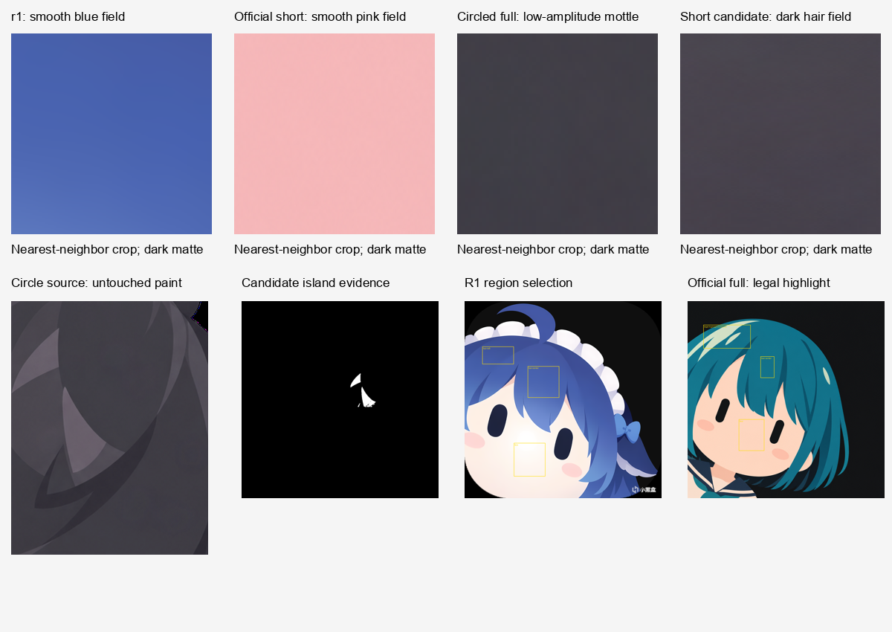

# 上色缺陷：像素证据与检测边界

2026-09-29。用户认可的是样本的整体形态，并未接受其上色。本次将微小纹理、独立亮片和透明度问题分开测量；不输出综合美术分。



## 结论

- 圈注图对应 `outputs/calibration/illustration/full-imagegen-v1.png` 的中央偏右发束，并非新附的首张 short 图。遮掉红线后的灰度相关定位与实际查看裁剪图均支持这个对应关系。[定位记录](annotation-registration.json)的相关系数仅 0.534，不作为精确配准保证；裁剪位置是近似的。所有测量在未画红线的源图上完成。
- full 的圈注上、下两个平滑色域，其中尺度残差分别为 **0.5765 / 0.5739**，超过事先用 r1 与官方 short-pink 冻结的 0.50 界限。相同规则下，未用于定界限的 short-blue、short-black、full-teal 平滑区域均未触发规则；补充的 r2 也没有触发。
- short 首图的细纹理在该界限下**没有被可靠地自动区分**。不能因此宣称它的上色合格，也不能为使它失败而重新压低界限。
- short 的碎高光区域产生 12 个色岛证据，full 圈注亮片区域产生 5 个。官方 full-teal 的合法高光同样产生 1 个，因此“有色岛”不是通用的坏高光判据。亮片是否顺着发束、是否符合单一光向，仍需 SVG 图层结构检查与人工看图。
- 新附 short 图在 1024 分析尺度下，远离透明轮廓的主体像素中 94.56% 的 alpha 小于 254，但这些值主要为 **251–253**，仅约 0.8–1.6% 透明。覆盖率大不等于透明程度大，不能把这个问题描述成上色缺陷的主要成因。它违反“主体内部不透明”的产物合同，并可能贡献少量合成底色噪声。

## 输入与溯源

[reference-audit.json](reference-audit.json) 列出相对路径、校准/保留验证角色和所有手动 ROI。r1 是用户指定的 DeepSeek 典型模式参考；这里仅测其干净色域，不从其水印或背景提取生产规则。r2 是补充参考，不替代 r1。

新附件 `ref/feedback/2026-09-29/accepted-composition-defective-paint.png` 与旧 `short-imagegen-v1.png` 尺寸同为 1254×1254，alpha 通道逐像素相同，RGB 通道不同。因此使用新附件进行本轮首图诊断，没有把旧文件当作相同输入。

工具使用 `SHA256("RGBA:<width>x<height>:" + decoded_RGBA_bytes)`，不把 PNG 编码差异当像素差异：

| 输入 | decoded RGBA SHA256 |
| --- | --- |
| 新附 short | `84995829139fa6329a136c654423f9ad797ef5decdd98a38b8f00cd48bd4f4b4` |
| 旧 short | `54830c0748513c59c57881437b48d11c273281a2f2f5f6dceb7483322792d32c` |
| r1 | `39ad18daa1e80361df17bbd4ac2ba24ca239e88618c695a15f6c01270307c49e` |

## 指标及预先确定的规则

分析将大图等比缩到长边 1024，不放大小图；使用 RGBA 的 straight RGB 数值，不将透明黑色直接混入颜色。可见像素下限 alpha=16。对输入小于 1024 的图片，像素尺度不同，不能直接套用本轮参考范围作等价比较。CI 应固定渲染分辨率。

1. **细纹理 grain**：原图与 Gaussian σ=1.5 px 低通之差的 RGB RMS，单位 0–255。
2. **中尺度 mottling**：Gaussian σ=1.5 与 σ=6 px 之间的 RGB RMS。它保留比细粒子更宽的斑驳起伏，允许合法、缓慢的连续渐变。
3. **采样边界**：ROI 内缩 3 px；梯度大于 2 RGB 单位/px 的边缘向外排除 12 px。报告采样像素数及其占 ROI 内部比例；少于 64 像素记为证据不足，不能通过 smooth_field 合同。
4. **透明度**：声明应不透明的表面 ROI 内部 alpha<254 比例不得超过 0.001。主体轮廓推断出的全图统计仅是证据，不能据此误判正常抗锯齿。
5. **色岛**：ROI 内 robust 二次曲面拟合去除大尺度色调；RGB RMS 残差至少 12，连通面积至少 12 px 且不超过 ROI 内部 25%。这是几何证据。仅当 ROI 事先声明为 `smooth_field` 时，意外色岛才违反该局部合同。
6. **彩边**：半透明边缘与 4 px 内最近不透明像素的 alpha 加权 RGB 差大于 32 时输出候选掩码。自然的相邻材料也可能触发，故它始终为 advisory，需对照透明、黑、白底查看。alpha=0 下的隐藏 RGB 不计入。

纹理界限在测量缺陷图前按 `max(0.50, 校准正例ROI最大值 × 1.5 + 0.15)` 分别冻结：grain=0.8276688285，mottle=0.50，见 [frozen-rules.json](frozen-rules.json)。校准样本只有 r1、short-pink，界限不随保留样本或坏图改变。工具未提供合同参数时的保守默认 grain=0.85、mottle=0.50；其他界限保持一致。这不是跨分辨率、跨风格的普遍保证。

| 角色/图像 | 平滑 ROI grain 范围 | 平滑 ROI mottle 范围 | 本轮解释 |
| --- | ---: | ---: | --- |
| 校准 r1 | 0.153–0.204 | 0.149–0.229 | 没有局部规则失败 |
| 校准 short-pink | 0.406–0.452 | 0.184–0.198 | 没有局部规则失败 |
| 保留 short-blue | 0.441–0.447 | 0.199–0.201 | 没有局部规则失败 |
| 保留 short-black | 0.438–0.456 | 0.198–0.199 | 没有局部规则失败 |
| 保留 full-teal（不含合法高光ROI） | 0.446–0.453 | 0.180–0.187 | 没有局部规则失败 |
| 补充 r2 | 0.343–0.446 | 0.289–0.397 | 没有局部规则失败 |
| 新附 short 的中央头发/面部 | 0.556–0.577 | 0.272–0.432 | 纹理未越界；不透明合同失败 |
| full 圈注上/下色域 | 0.593–0.599 | 0.574–0.577 | 中尺度纹理及不透明合同失败 |

新附 short 的右侧两个 ROI 包含发束交界，查看 overlay 后只保留 `opaque_surface` 合同；其中的色岛不能冒充“不该有的高光”。所有灰度、颜色、透明度证据分别输出，避免一个 sharpness 分数遮掉机制差异。也没有把合法渐变全部禁用。

## 工具和 CI 接口

仅依赖 Python、Pillow、numpy、scipy，不联网、不调用绘图模型。依赖属于研发/CI 检查器，不是技能分发的强制依赖。

```text
python tools/analyze_paint_fields.py --image ref/feedback/2026-09-29/accepted-composition-defective-paint.png --regions docs/validation/paint-fields/evidence/user-defect/regions-used.json --output .local/paint-recheck --timeout 60 --fail-on-issues
python -B -m unittest discover -s tests -p test_paint_fields.py -v
```

`--fail-on-issues` 返回 2 表示合同失败；检测完成但没发生规则失败返回 0；超时返回 124。没有 `--regions` 时只给全图证据，绝不代表视觉通过。

最小合同：

```json
{
  "schema": "aikon.paint-fields.v1",
  "long_edge": 1024,
  "regions": [
    {"id": "surface-a", "bbox": [0.3, 0.3, 0.45, 0.45], "expectation": "smooth_field"}
  ]
}
```

支持归一化 `polygon: [[x,y], ...]` 替代 bbox；`expectation` 可为 `smooth_field`、`opaque_surface`、`evidence_only`。可提供 `rules` 与 `threshold_provenance`。禁止仅为了得到绿灯，把真实平滑表面改为 evidence_only；ROI 的身份和用途应在查看输出前写进绘图合同。

Python API：`analyze_image(PIL.Image, contract, region_masks=None) -> (report, maps)`；`save_evidence(output, report, maps, contract)` 保存 JSON、region 掩码、色岛/透明度/彩边掩码及固定色标热图。热图黑=0、红=1.5、黄=3+ RGB 单位，显示用量化不影响原数值。结果中的 `visual_acceptance` 始终为 `not_assessed`。生产接口可通过 `mask_id` 引用与原图同尺寸的二维 bool mask；尺寸/类型错误、未知/空mask及混用bbox均拒绝，缩放mask使用nearest，不把边界平滑扩散成内部样本。

14 个诊断测试通过（含真实PNG回归与外部mask API）：平色、线性渐变、轻径向渐变、可控细粒噪声、中尺度起伏、内部半透明、额外碎色岛、合法高光只作证据、正常抗锯齿与透明隐藏 RGB、异色半透明彩边、无 ROI 模式及非法合同（部分项目合并在同一个 test 中）。合成负例是外加独立图像扰动，不复制检测公式生成期望结果。

这些检查不能证明任意模型、任意主体的视觉效果一致。生产应从 SVG 表示层限制噪声/纹理、未规划的亮片及不合理图层，再以固定渲染器、正负控制和实际看图复核。本报告没有完成未知高光语义的自动判定。

## 证据索引

- [完整结构化摘要](summary.json)
- [圈注对应无红线源裁剪](annotation-matched-crop.png)
- [新附 short：指标](evidence/user-defect/metrics.json)、[ROI](evidence/user-defect/regions-overlay.png)、[亮片证据](evidence/user-defect/islands-mask.png)
- [full 圈注：指标](evidence/full-circled-source/metrics.json)、[ROI](evidence/full-circled-source/regions-overlay.png)、[mottle 热图](evidence/full-circled-source/mottle_energy-heat.png)
- [r1：指标](evidence/r1/metrics.json)、[ROI](evidence/r1/regions-overlay.png)
- [官方合法高光：指标](evidence/full-teal/metrics.json)、[ROI](evidence/full-teal/regions-overlay.png)

每个 evidence 子目录均保留实际使用的 regions-used.json 与编号 region 掩码。报告图是诊断材料，不是重画结果或用户验收。
