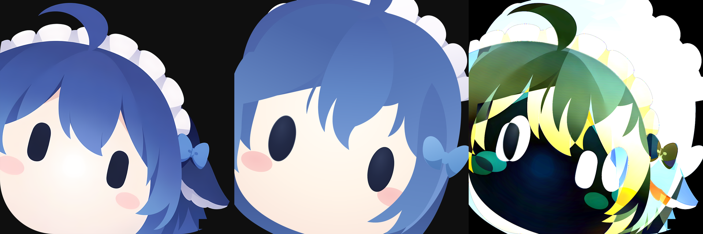

# r1 固定坐标比较协议

本协议提供真实 SVG 渲染与 r1 的差异证据，不把任何单项指标或总体分数称为用户的“99% 相似度”。姿态语义、鲸鱼形态辨识、光泽自然度和用户验收均不由此自动判定。协议在测量新候选之前从原图冻结；首次候选测量仅使用已被用户拒绝的 round-002 作为失败对照。

## 不变参考与排除区域

- 原图：`ref/user-mode/r1.png`，1280×1280，SHA-256 `5a16fe96fab6c06548c87250539739cc4d6dac5e1fed6628f65890a76683817e`。
- 协议：[frozen/protocol.json](frozen/protocol.json)，SHA-256 `825f2d2415a6ca986468c7a206eb1687718c5be71792f2f4522d42dbd9923c34`。
- 水印排除：原图右下 `[1086,1198,1246,1252)`，坐标顺序 x0,y0,x1,y1，右/下界不含。8640 像素，占画布 **0.52734375%**。
- [排除区域图](frozen/watermark-exclusion-mask.png)和[水印局部检查图](frozen/watermark-inspection.png)仅为诊断，不是去水印后的参考或新作品。矩形内未被水印覆盖的少量原有内容也无法评分，这是已公开的覆盖缺口；不得随候选结果扩展此区域。
- 原图未修改；不同哈希的清理版或替换版会拒绝比较，需要独立命名的新协议，不能悄悄覆盖本轮目标。

## 尺度与背景

候选必须为经过现有静态 SVG 检查器验证的真实矢量，实际通过 pinned resvg 渲染为1280×1280 PNG。调用方必须显式声明原始 SVG 画布尺寸，例如1024或1280；width、height、viewBox必须全部与声明一致。全画布固定缩放至1280是唯一标准化步骤，没有裁切、配准、旋转、部件移动、任意 warp 或从候选反推的对齐。

r1 的黑色并非全是透明区域：其主体之外包含 `#0f0f0f` 不透明圆角背景及少量透明外角。因此候选的透明背景先统一合成到 `#0f0f0f`，原图也合成到同一底色，才比较RGB。源图黑底本身不计为错误，候选是否真正透明另外由 alpha 报告揭示。

参考主体 mask 只从冻结原图计算：原始 alpha≥128，且 RGB 对 `[15,15,15]` 的最大绝对通道差>8。它能区分此参考的彩色主体与黑底，但只是**源图推定的主体代理 mask**，并非已知原始人物 alpha。抗锯齿混色、黑色贴近底色的局部可能存在1–数像素的不确定性；不得将这个 mask 的 IoU 单独解释成精确的矢量轮廓正确率。

## 报告内容

1. 参考主体、背景和全有效画布分别报告 RGB MAE、RMSE（0–255 sRGB尺度）、最大通道误差的95分位数、误差≤2和>16的像素比例。主体结果单列，不能用大片相同背景稀释；全画布结果仅为辅助。
2. 脸与姿态上下文、左右眼、主发流、顶端弯钩、头侧鳍、侧蝴蝶结、白边分别使用[固定局部框](frozen/frozen-regions.png)。每框报告上下文及参考主体部分的误差。这些是定位用的上下文框，部分相互重叠，**不是精确语义分割，也不能把各框分数平均成独立部件评分**。
3. 参考主体代理与候选 alpha≥128 的 IoU、漏失/新增像素，以及8邻域内边界的双向距离。边界报告平均值、95分位、最大值和两侧样本数，全部为1280像素尺度。
4. 计算边界时对固定有效域侵蚀2像素，以免把画布裁切或水印遮挡框形成的边界当作真实轮廓；此规则不依赖候选。有效域没有边界时明确报告 `missing_boundary`，不补造0距离。
5. 参考主体的候选平均 alpha、参考背景的候选平均 alpha，以及背景中 alpha≥128 的候选像素数，防止通过画黑色实体背景冒充透明产物。
6. 源图/协议/候选SVG/真实渲染PNG的哈希和渲染器版本，连同原始差值图、4倍差值图、50%叠加图、alpha图与三联比较图。

没有实现 SSIM 或感知语义分数，也没有任何自动“99%达标”阈值。这里的常规误差定义为：MAE是有效RGB通道绝对误差均值，RMSE是均方误差开方；边界距离由 scipy 的欧式距离变换计算。所有分数是局部几何和颜色证据，不能证明任意Agent已学会从提示词创作。

## 调用

```text
python tools/compare_r1_reference.py --freeze --output docs/validation/r1-comparison/frozen
python tools/compare_r1_reference.py --candidate <candidate.svg> --canvas-size 1280 --output <new-comparison-directory>
```

生产 API：`compare_svg(reference_path, candidate_path, output_dir, *, canvas_size)`；返回完整 report。`compare_pixels`只是测试/测量接缝，不证明SVG来源。比较输出目录必须为空或新建，保留既有证据；协议冻结若遇到不同内容会拒绝覆盖。调用程序必须设置硬超时；当前验证使用仓库已有 `run_bounded`，无新依赖。

## 已执行的验证

`tests.test_r1_comparison` **11项通过，10.991秒**；测试进程硬超时55秒。涵盖保持背景但改错主体、左眼独立平移、头侧鳍独立平移、仅水印区改动完全不影响数值、参考哈希变更、透明主体丢失、错误像素尺寸、未声明画布变更、内部整体缩放不会自动对齐、禁止修改已冻结协议、真实SVG渲染及差值/叠加产物。

[已拒绝 round-002 的对照结果](rejected-round-002/report.json)由其实际 `short.svg` 渲染得到；未对已拒绝图调整指标：

| 测量 | 结果 |
|---|---:|
| 参考主体RGB MAE | 52.7733 /255 |
| 参考主体RGB RMSE | 80.5095 /255 |
| 主体alpha代理IoU | 0.762432 |
| 轮廓双向平均距离 | 125.0815 px |
| 轮廓双向95分位距离 | 324.4226 px |



这些结果揭示了旧图的大面积位置与形状错误，没有宣称目标已经完成。原图、候选、Skill、CI均未被比较器修改。
