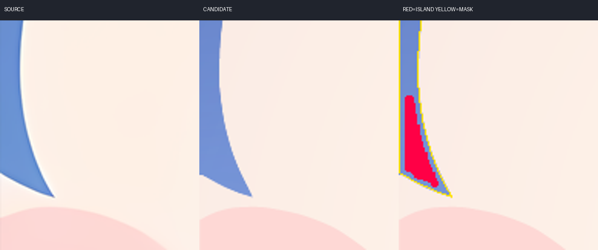
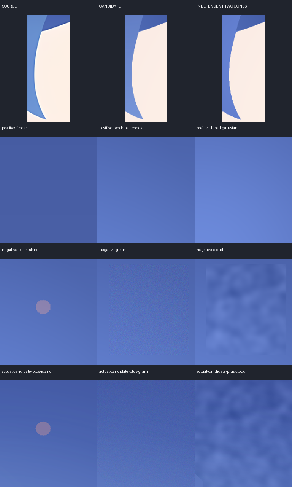

# v006 主发区色岛复核

当前唯一 `hair-front-main` 色岛报警主要来自**全材料单一二次趋势模型失配**。报警位于画面最左侧、贴脸发梢的连续蓝色区域，未观察到独立亮片或杂色块；423 个报警像素全部属于最终 SVG 可见主发区，没有混入脸、腮红或其他材料。此结论只解释这一条报警，原 `paint.json` 的 fail 保留，不能据此宣布 v006 材质、视觉或用户验收通过。

## 精确位置与图像证据

实际查看了正确源图、v006 候选全图、下面的放大裁图和控制板。唯一 source 是 `ref/subjects/deepseek/cetus-desktop/r1-clean-source-1280.png`，SHA256 `60c234f594ad81319fa74bb4fa8392f10a125127d46bf1d3b47e618b25813da2`。没有使用弃用的 calibration 图。

候选为 `outputs/calibration/deepseek-r1/revisions/v006/short.svg`，SHA256 `0e662b8789d71a5baf6e3f1ee4c27af3033a5e75c72ae63d99e7a40691a3c297`。现有 `comparison/candidate-render.png` decoded hash 与历史质量报告完全相同。使用 `paint-study/natural-fields-v6/final-fit/geometry-input/masks/hair-front-main.png`；重新执行未改动的分析器后，主发区完整 region 结果与历史报告逐字段相等。



|项目|实测|
|---|---|
|1024 分析网格 bbox，右下界不包含|`[3, 623, 21, 671]`|
|对应 1280 源画布范围|`x=3.75–26.25, y=778.75–838.75`|
|报警面积|423 px|
|二次趋势残差对比度中位数|15.8798 RGB units|
|残差亮度中位数|−17.1677，属于暗残差|
|候选报警区 RGB 范围|`[111,141,210]` 至 `[118,148,215]`|
|候选报警区 RGB 中位数|`[116,146,213]`|
|全域二次模型在该区预测 RGB 中位数|`[133.43,163.23,224.73]`|
|最终绘制栈中的主发归属|423/423 完全归属主发；0 像素混入后画材料|

图中红色只表示残差超过阈值，不是原图本身的颜色。候选发梢从上至下连续变色，没有红色覆盖形状对应的闭合颜色边界。该处相对源图有轻微色相差：RGB 差值中位数为 `[+7,−3,+1]`，RMSE 为 4.8697；邻近材料内环带的差值为 `[+9,−2,+2]`。这是一片连续的偏色，不能将其解释为只存在于报警轮廓内的色岛；是否还需匹配源图色相属于另外的视觉修正判断。

归属检查不是将声明色场重放后比较相等：先独立渲染实际 SVG 的主发裁剪路径，再将完整绘制栈按主发白／其他材料黑重新渲染，保留所有裁剪和后画遮挡。两项都覆盖全部 423 像素，排除了本报警由材料掩膜混入脸色等内容的解释。

同样的二次拟合限制在整个左发束（原材料与 `x<60,y>=680` 的交集，1024 网格共 1021 个内区像素）时，原报警处的对比度中位数降至 0.4879，最大 1.0876。这只是拟合域敏感性诊断：它说明全局预测在细长末梢偏高，**没有把该局部拟合当作新 gate，也没有验证其对细发束内污染的敏感性**。

## 独立正负控制

控制只在同一声明主发材料内改像素，材料外保持实际候选；分析器、冻结规则和原 mask 不变。独立场只按画布坐标与固定常数构造，未加载 `paint-fields.json`、未使用源图拟合、未根据报警反向优化。负例既施加于独立场，也施加于实际候选。



|输入|色岛结果|完整支持 grain RMS|完整支持 mottle RMS|说明|
|---|---|---:|---:|---|
|独立线性场|0|0.0839|0.1158|基线正控制|
|两个宽径向 cone 叠加|左发梢 398 px，contrast 15.8836|0.2040|0.1279|连续合法宽色场重现同位置假岛|
|独立宽 Gaussian radial|0|0.2183|0.1154|另一类平滑正控制|
|双 radial + 色岛|新增中央 353 px，contrast 34.0787|0.4164|0.7993|保留原假岛，同时找到新注入位置|
|双 radial + 噪点|grain 原规则触发|1.0529|0.2945|局部注入标准差 5|
|双 radial + 云纹|mottle 原规则触发|0.2746|0.9248|局部空间相关噪声|
|实际候选 + 色岛|新增中央 351 px，contrast 33.2636|0.4391|0.8208|原 423 px 报警仍在|
|实际候选 + 噪点|grain 原规则触发|1.7143|0.4707|内缩 32px 材料内注入标准差 3|
|实际候选 + 云纹|mottle 原规则触发|0.5748|2.1718|内缩 32px 材料内注入|

完整支持 RMS 是附加证据，不等于旧门禁全部采用该值。例如色岛注入的 mottle 完整支持值超过 0.50，但旧门禁只报 island；原 `near_edge` 会排除这类强变化邻域。

双 cone 的径向半径分别为 `(570,510)` 和 `(550,480)` 原生像素，中心为 `(60,730)`、`(480,770)`。其假岛 bbox 是分析网格 `[3,626,21,671]`，与实际 `[3,623,21,671]` 高度重合。该连续场本身的定义不含离散色块，故它构成“单一二次模型足以解释所有合法宽 radial”假设的独立反例。Gaussian 正例未报警，表明不能泛称所有径向场都失败。

源图另选完全位于中央蓝色刘海的独立矩形 `x=390–625,y=420–680`，不借候选 mask，结果无规则失败、无色岛，完整支持 grain/mottle 分别 0.2157/0.1408。该控制只覆盖源图这一片明确材料内区。源图套用候选全 mask 的结果也保留在 JSON，但它不是源图分割真值，不作为放行理由。

## 可执行的下一步

1. **本次不建议为消除 423px 报警把左发梢涂平、提亮或裁掉。** 现有证据支持先修正检测模型的适用假设。全材料单一二次趋势不能同时拟合宽面与细长末梢的连续二维色场，残差阈值的超限不直接等于杂色。
2. 下一版诊断原型应使用有明确最小空间尺度、曲率约束及稳健留出策略的材料内低频基线，或按独立几何定义的发束坐标分析；不能任意加拟合自由度把缺陷吞掉，也不能自动排除高梯度像素。先用这里的双宽 radial 正例与中央色岛／噪点／云纹负例检验，再扩大到细发梢内的注入、不同大小／强度／位置，验证局部方法是否会吸收缺陷。当前没有实现或验收这一新模型。
3. 原 `unexpected_color_islands_in_declared_smooth_field` 留在 v006 原报告中。本复核可作为“该部位模型失配”的人工解释附件，不能自动转为全图 pass。source 色相匹配和发梢边缘质量若要修正，应单列视觉依据，不伪装成色岛检测闭环。

尚未评估：这 423px 区域没有任何完整 49×49 mottle 核支持，故全主发支持内 mottle=0.2338 不能证明该细发梢在这个尺度没有云纹。细发束局部低频缺陷、局部拟合负例敏感性、任意自然高光的审美判断、其他材料、full 版均未在本报告中验收。

## 证据与复现

- [实际图像测量](real.json)：输入哈希、完整原 region、可见归属、局部域敏感性、源图独立材料 ROI。
- [控制测量与生成定义](controls.json)：9 个控制的原 issues、精确岛位置与支持覆盖。
- [有界复核脚本](review.py)：两个模式各自硬超时 40 秒；只写本目录。实际 worker 的主体测量分别约 2.50 秒和 9.77 秒，不安装、不联网、不改分析器或候选。

```text
.local/ci-venv/Scripts/python.exe -B docs/validation/v006-material-review/review.py real
.local/ci-venv/Scripts/python.exe -B docs/validation/v006-material-review/review.py controls
```

这是一份窄范围诊断证据，不是全仓库审计、检测器新版本或已通过视觉验收的声明。
