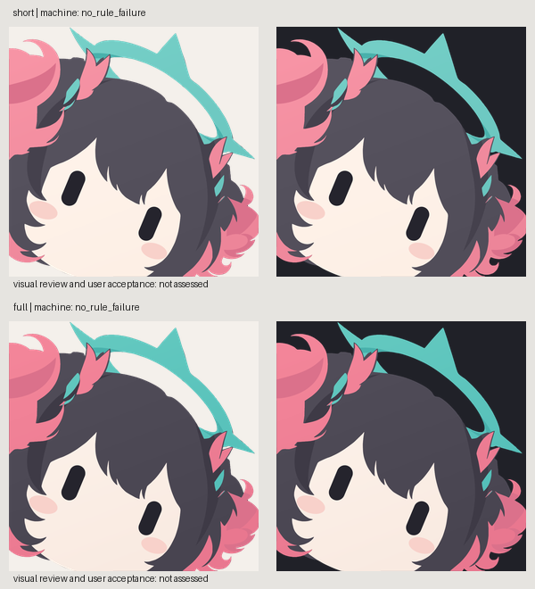

# 单例上色 v6

2026-09-29。这是对用户认可的整体方向进行上色清理的候选，不是最终视觉验收。主体仍是原立绘中的女孩，姓名未确认；本目录不是 DeepSeek 产物。DeepSeek 的另一个主体合同已改绑 r1。

| 版本 | 实际 SVG | 生产提示词 | 上色计划 |
| --- | --- | --- | --- |
| short | [short.svg](short.svg) | [中文 prompt](short.prompt.zh-CN.md) | [paint plan](short.paint.json) |
| full | [full.svg](full.svg) | [中文 prompt](full.prompt.zh-CN.md) | [paint plan](full.paint.json) |

## 本次改动

固定源几何 `outputs/calibration/illustration/vector-study/semantic-study-v4.svg`，SHA-256 `bc296c212317b4ecffaedadab125e135f5bf9f063bd0e6ba67e1999a48e83b6f`。它源于前轮模型辅助诊断和手工语义矢量重建，并非用户原PNG的每条曲线都已认可。

每版保留14个可寻址绘制层，重建4个宽缓、双色、低幅线性色场，眼睛/腮红纯色。移除旧高光、透明叠色与未选中的色片，主体内部不透明；透明画布与边缘抗锯齿保持。真实路径与clip构成SVG，不含位图。

v5 的 `center-fold-shadow` 距 hair receiver 边界3px，未通过冻结2px规则。v6删除该阴影而没有放宽阈值；其余轮廓、眼位、附件连接保持。prompt沿用v5的实际上色指令，反馈修正记录在plan notes与此文，不将事后说明冒充新的prompt试验。

## 已查看与保留问题

主线程实际查看1024px渲染和深浅底预览：内部没有前图的云纹和尖碎亮片，双眼清晰，珊瑚发束与青绿环可辨，深浅底未见黑色底块。整体更干净，但中央头发的内部层次偏少；删除阴影不是证明所有头发都应该一整块平涂。新版本仍待用户评价，不能将机器无规则失败写成美术合格。

编译/渲染不调用绘图模型或外部API。相同源和plan可重复输出；本例不能证明所有模型会从原始角色图提取同一几何。实际检查详情见[本地E2E证据](../../../docs/validation/paint-fields/e2e-final.json)，编译报告中的未运行视觉项保持原始状态，完整E2E和人工观察另外记录。
